# feat: 6S 70 A ESC for the Serenity-UAV 64 mm nacelle bays (issue 23)

Governed by [`AGENTS.md`](../../AGENTS.md). TODO index: `TODO.md` §19.
AI-generated plan (Claude, Anthropic), 2026-11-22. Not human-reviewed.

> **WARNING** — Issue 23's G1 envelope is **invalid** (issue comment
> 2026-11-22, Serenity-UAV commit `3d23e68`, WBS NAC-64-ESC-SKIN-RAY). The
> bay optimiser read the far-side skin radius. With the skin corrected, no
> bay of this design fits the ventral half (port azimuth 45°–150°), where
> both ESC B bays sat. Do not lay out a board to any G1 figure. Sprints after
> **Gate E** stay closed until Serenity-UAV posts a corrected envelope on
> issue 23 and the owner decides on it.

> **CAUTION** — Serenity-UAV OD-3 accepted only the existing 70 A design. A
> re-partitioned board is a different ESC. It shall get the full thermal,
> creepage, layout and qualification analysis (Serenity-UAV WBS
> NAC-64-ESC70-QUAL) before it flies.

---

## Goal Capsule

- **Objective:** design, build and bench-qualify two 6S 70 A ESCs (A: forward
  motor; B: aft motor) that fit the corrected 64 mm nacelle bay envelope.
- **Authority:** `AGENTS.md` > Serenity-UAV envelope as posted on issue 23 >
  this plan > `docs/solutions/` learnings. On conflict between repos, stop
  and ask the owner.
- **Stop conditions:** a sprint stops and writes a handoff when (a) its exit
  gate passes, (b) the usage window reaches its stop line (KTD7), or (c) a
  value cannot be traced to a primary source. In case (c), mark it
  `UNVERIFIED — needs primary source (see TODO.md)` and keep working only on
  items that do not depend on it.
- **Execution profile:** 19 sprints (U1–U19). Each fits one Claude Pro
  5-hour usage window. Human gates: E (envelope), P (partition pick),
  F (fab order) and Q (bench runs).
- **Tail ownership:** each sprint commits on its branch. The PR and issue-23
  replies are owner-approved.

---

## Product Contract

### Problem Frame

Serenity-UAV design F1 moved the nozzle housing forward to Z 6.31 in
(160.25 mm). The OD-3 bays lost their aft length. G1 then moved the bays
forward, but its areas came from a bad skin ray. The real fit is unknown
until Serenity-UAV re-plans against the corrected skin. The keep-outs that
drive that re-plan are the servo, trunnion and nav-light. This repo has **no
70 A board yet.** The "accepted 70 A design" exists only as Serenity-UAV's
`tools/esc70_design.json`: the 50 A faceted courtyards rescaled, with 2 FETs
per leg, 1 shunt per phase, 2 oz copper and `axial_two` isolation.

### Requirements

Electrical (unchanged by the comment):

- R1. 6S input, 70 A rating, 70 A firmware current limit.
- R2. One 0.5 mΩ shunt per phase.
- R3. Motor QF2822-2300KV: 57.0 A at 24 V, 60 A for 10 s.
- R4. Isolated CAN-FD and RS-485 with 0.295 in (7.5 mm) creepage and
  clearance, input to output [9] Table 6.

Envelope (pending Gate E):

- R5. Each board fits the corrected per-bay envelope: axial run, panel widths,
  radial stack and per-face area. Until the corrected envelope is posted,
  carry the G1 radial-stack limits as the working assumption: outer ≤ 0.104 in
  (2.65 mm), power bay ≤ 0.079 in (2.0 mm), inner ≤ 0.043 in (1.1 mm),
  PCB 0.063 in (1.6 mm). See KTD3.
- R6. ESC A's leads all exit forward. ESC B's pack and signal leads exit
  forward and its phases exit aft (issue 23 §3).
- R7. Harness bend radii ≥ 3× OD (NASA-STD-8739.4A Chg 3 Table 7-1, as cited
  in issue 23). This needs a `REFERENCES.md` entry before use (U1).

Validation:

- R8. Thermal: verified channel and junction temperatures with margin at
  60 A for 10 s and 44 A sustained. This replaces the unverified 164.8 °F
  (73.8 °C) bay model.
- R9. Mass, power loss and clearance budgets are reported per sprint in lbm,
  W and in (mm). No "TBD" figure ships.
- R10. ERC and DRC are clean, or each violation is documented by rule and
  reason (SecureControllers `CLAUDE.md`).
- R11. Bench qualification evidence is mapped item by item to Serenity-UAV
  NAC-64-ESC70-QUAL.

### Scope Boundaries

- In: both ESC boards (power + logic per ESC), interconnect, firmware current
  limit and shunt scaling, test procedures and bench data reduction.
- Out: nacelle geometry, bay optimiser fixes and the
  `nacelle_hollow_profile.py` wall check. Serenity-UAV owns all of these.
- Out: motor selection and flight qualification (Serenity-UAV).

### Deferred to Follow-Up Work

- Promote `score_placement.py` to repo `tools/` (TODO 14.0). Do this only if
  U10 needs it from two builds.
- Rigid-flex hinge, which stays gated on TODO 16.2 (IPC-2223/6013 not
  obtained).

---

## Planning Contract

### Key Technical Decisions

- KTD1. **Split the plan at Gate E.** U1–U7 do not depend on the bay
  geometry, so they run now. U8 onward needs the corrected envelope. Reason:
  the comment voids every area figure but leaves R1–R4 intact.
  (session-settled: user-directed — chosen over waiting for the envelope:
  "note it before settling the plan".)
- KTD2. **Partition by trade study, not by commitment.** U8 scores the options
  against the corrected envelope, and the owner then picks (Gate P).
  (session-settled: user-directed — chosen over committing now to isolators
  on the power board.)
- KTD3. **Make the schematic partition-agnostic.** U6 puts each isolated
  interface (ADM2582E/ADM2587E, its barrier, its connector) in its own
  hierarchical sheet. This lets U8 move a block between power and logic
  boards without a schematic rewrite.
- KTD4. **Build an envelope-driven fit scorer before the envelope arrives.**
  U2 writes `docs/tools/bay_partition_fit.py`. It takes a bay-list JSON (the
  shape of Serenity-UAV's `bays` output) plus a partition option and returns
  per-face margins. When the corrected envelope lands, U8 is a script run,
  not a re-derivation.
- KTD5. **Name the build folders on the existing axes.** Use
  `builds/6s/70A/CAN_485_faraday_sameend_faceted/` for ESC A (all leads
  forward) and `builds/6s/70A/CAN_485_faraday_faceted/` for ESC B (opposite-end
  egress). Both inherit from the 50 A faceted builds.
- KTD6. **Use separate rigid boards for the hinge by default**
  (`Faceted separate boards`), joined by the inter-board loop. Reason:
  rigid-flex is blocked by TODO 16.2.
- KTD7. **Pro-window sizing.** Anthropic does not publish a fixed token count
  for the Pro 5-hour window, so each sprint is sized by work volume:
  - one deliverable per sprint;
  - a cold start reads only this plan's sprint section and the files it
    names;
  - stop at about 70 % of the window and write a `ce-handoff` note.
- KTD8. **Model tiers.**
  - **Simple:** the smallest/fastest tier, for mechanical runs and packaging.
  - **Moderate:** the mid tier, for schematic, BOM, routing and procedures.
  - **Advanced:** the top reasoning tier, for trade studies, power design,
    thermal and independent review.

  Advanced sprints use the window fastest, so they are scoped narrowest.

### Token-Optimization Rules (all sprints)

1. Read `TODO.md` by section only (it is ~2,400 lines). Never read it whole.
2. Find learnings with `grep applies_when: docs/solutions -r`, then read only
   the hits.
3. Get Serenity-UAV files by sparse, shallow clone of the named paths only.
4. Run scripts for numbers. Never re-derive a calculation that
   `docs/tools/*.py` already holds.
5. Send broad multi-file sweeps to an Explore subagent and keep only its
   conclusion.
6. End each sprint with `ce-handoff`: what changed, the open items, and the
   next sprint's first read.

### High-Level Technical Design

```mermaid
flowchart LR
  subgraph Now[Envelope-independent]
    U1[U1 Setup] --> U2[U2 Fit scorer]
    U1 --> U3[U3 70 A power design]
    U3 --> U4[U4 BOM + heights]
    U4 --> U5[U5 Symbols/footprints]
    U5 --> U6[U6 Schematic, modular]
    U3 --> U7[U7 Firmware limit]
  end
  E{{Gate E: corrected envelope}}
  U2 --> E
  U6 --> E
  E --> U8[U8 Partition trade] --> P{{Gate P: owner pick}}
  P --> U9[U9 Hinge/interconnect] --> U10[U10 Binding ESC place]
  U10 --> U11[U11 Other ESC place] --> U12[U12 Thermal]
  U12 --> U13[U13 Power route] --> U14[U14 Signal route]
  U14 --> U15[U15 Independent review] --> U16[U16 Fab release]
  U16 --> F{{Gate F: fab + assembly}}
  U16 --> U17[U17 Test procedures]
  F --> Q{{Gate Q: bench runs}}
  U17 --> Q
  U7 --> Q
  Q --> U18[U18 Bring-up data] --> U19[U19 Qual + close-out]
```

### Assumptions

- The G1 radial stack and panel widths survive the re-plan (R5). U8
  re-checks them on arrival.
- Two bays per ESC may not survive. A dorsal-only envelope may force fewer,
  longer bays, so U2's scorer shall take any bay count.

---

## Implementation Units

| U-ID | Sprint | Tier | Files touched | Depends on |
| --- | --- | --- | --- | --- |
| U1 | S0 Setup and baseline | Simple | `REFERENCES.md`, `TODO.md` §19 | — |
| U2 | S1 Fit scorer | Moderate | `docs/tools/bay_partition_fit.py` | U1 |
| U3 | S2 70 A power design | Advanced | `builds/6s/70A/*/README.md` | U1 |
| U4 | S3 BOM + heights | Moderate | build READMEs, `REFERENCES.md` | U3 |
| U5 | S4 Symbols/footprints | Moderate | `symbols/` | U4 |
| U6 | S5 Modular schematic | Advanced | `builds/6s/70A/*/kicad/` | U5 |
| U7 | S6 Firmware limit | Moderate | SecureControllers `firmware/` | U3 |
| U8 | S7 Partition trade | Advanced | `docs/design-70a-nacelle64-partition.md` | Gate E, U2, U6 |
| U9 | S8 Hinge/interconnect | Moderate | build READMEs, schematic | Gate P |
| U10 | S9 Place binding ESC | Advanced | binding build `kicad/` | U9 |
| U11 | S10 Place other ESC | Moderate | other build `kicad/` | U10 |
| U12 | S11 Thermal | Advanced | `docs/design-70a-nacelle64-thermal.md` | U11 |
| U13 | S12 Power routing | Advanced | both `kicad/` | U12 |
| U14 | S13 Signal routing | Moderate | both `kicad/` | U13 |
| U15 | S14 Independent review | Advanced | review log in build READMEs | U14 |
| U16 | S15 Fab release | Simple | `builds/6s/70A/*/gerbers/` | U15 |
| U17 | S16 Test procedures | Moderate | `docs/test-70a-nacelle64-bench.md` | U15 |
| U18 | S17 Bring-up data | Moderate | test doc results | Gates F, Q, U7, U17 |
| U19 | S18 Qual + close-out | Advanced | results, `docs/solutions/` | U18 |

Estimates are in Pro windows (optimistic / most likely / pessimistic).

### U1. S0 — Setup and baseline (Simple; 0.5 / 1 / 1)

- **Goal:** a ready toolchain, a pinned cross-repo baseline, and a clean
  citation base.
- **Requirements:** R7, R10.
- **Tools to install:** `pip install kiutils`; FreeRouting comes as
  `freerouting.jar` in the `autoroute` skill (Java is present); `scipy` (not
  installed). `kicad-cli` 9.0.2, ngspice, OpenFOAM, OpenSCAD and pdftotext
  are present.
- **Skills:** `ce-setup` (user-run; done 2026-11-22), `datasheets`,
  `research`.
- **Approach:**
  1. Sparse-clone Serenity-UAV `Theme-N-S2-S6` at `3d23e68` or later. Fetch
     only `tools/esc70_design.json`, `tools/esc80_cooptimize.py` and
     `tools/esc_f1_pivot_iter.py`.
  2. Record the pinned commit in the build READMEs.
  3. Add NASA-STD-8739.4A Chg 3 to `REFERENCES.md` (verified URL, Table 7-1).
  4. Log the duplicate `[67]` tag (CNAF M-3710.7 and WE-SHC share it) in
     `TODO.md` as an owner decision. `AGENTS.md` §2.5 forbids renumbering a
     tag, so do not renumber it.
- **Test scenarios:**
  - At the pinned commit, Serenity-UAV's own `test_esc80_cooptimize` passes,
    including the re-pinned model-1 golden (−60.51) and the near-side
    `skin64` regression. Issue 23's "today" figures predate `3d23e68`, so do
    not use them as a golden.
  - `kicad-cli --version` reports 9.x, and `import kiutils` succeeds.
- **Verification:** the toolchain check passes, and the TODO §19 line exists.

### U2. S1 — Envelope-driven fit scorer (Moderate; 1 / 1 / 2)

- **Goal:** a script that scores any bay list against any partition option
  (KTD4).
- **Requirements:** R4, R5, R6.
- **Tools:** Python 3, `scipy` only if the solver needs it.
- **Skills:** `test-driven-development`, `negative-controls`,
  `electronics-engineering`.
- **Files:** `docs/tools/bay_partition_fit.py`,
  `docs/tools/test_bay_partition_fit.py`.
- **Approach:**
  - **Inputs:** a bay list (azimuth, axial run, per-face area per panel,
    height caps, egress direction) and a part-area table from
    `esc70_design.json`.
  - **Barrier geometry:** reuse `isolation_envelope.py`. Do not copy it.
  - **Options:** `axial_two`, one shared barrier, a lateral barrier,
    isolators on the power board, and cross-bay splits.
- **Execution note:** test-first. Use the invalid G1 table as an arithmetic
  golden only: ESC B logic −534 mm²/face and ESC A total +81 mm²/face. Feed it
  the G1 bay list from the pre-fix commit `e8b1299`, which produced those
  numbers.
- **Test scenarios:**
  - With the G1 bays and `axial_two`, the script reproduces issue 23's four
    per-bay margins.
  - Negative control: a bay with its area set below the barrier area alone
    scores "no fit" for every option except isolators off-bay.
  - A bay list with one bay per ESC is accepted and scored. Two bays per ESC
    is not assumed.
  - A malformed bay JSON (missing height cap) is refused with a named field.
- **Verification:** all tests pass, and the script is documented in
  `docs/tools/` with its sources.

### U3. S2 — 70 A power-stage design delta (Advanced; 1 / 1 / 2)

- **Goal:** cited 70 A values for FETs, shunts, current sense, copper and
  loss.
- **Requirements:** R1, R2, R3, R8, R9.
- **Tools:** ngspice (`spice` skill), `docs/tools/conductor_sizing.py`,
  `via_current_budget.py`.
- **Skills:** `electrical-engineering`, `electronics-engineering`,
  `kicad-highcurrent`, `spice`, `datasheets`, `doubt-driven-development`.
- **Files:** `builds/6s/70A/CAN_485_faraday_faceted/README.md`,
  `builds/6s/70A/CAN_485_faraday_sameend_faceted/README.md`.
- **Approach:**
  1. Start from the 50 A faceted parent (KTD5).
  2. Size 2 FETs per leg (TPHR8504PL [49]), each 0.5 mΩ WSLP2512 shunt, and
     the INA240 gain for a 70 A full scale.
  3. Set the DRV8353S gate drive.
  4. Sum the loss at 44 A sustained and at 60 A for 10 s.
  5. Mark the IPC-2152 gap [46] as UNVERIFIED wherever copper width depends
     on it.
- **Test scenarios:**
  - At 70 A, the shunt voltage times the INA240 gain stays inside the ADC
    range with headroom.
  - The conduction-plus-switching loss total is reported in W, and its
    difference from the 42.6 W harness figure is explained.
  - Phase copper cross-section from `conductor_sizing.py` is given for each
    current case.
- **Verification:** every value cites a `REFERENCES.md` tag or is marked
  UNVERIFIED in `TODO.md`.

### U4. S3 — BOM and height verification (Moderate; 1 / 1 / 2)

- **Goal:** every new or changed BOM line is verified against its datasheet
  and against the R5 height caps.
- **Requirements:** R5, R9.
- **Tools:** pdftotext.
- **Skills:** `bom`, `datasheets`, `digikey`, `mouser`, `lcsc`, `jlcpcb`.
- **Approach:**
  - Close the open item from `esc70_design.json`: 1210 bulk caps ≤ 0.079 in
    (2.0 mm).
  - Check the WE-SHC shield height of 1.7 mm (ref., assembled).
  - Get country of origin per the TODO 18.4 pattern.
- **Test scenarios:**
  - Each power-bay part's maximum height is ≤ 2.0 mm, taken from its own
    datasheet drawing.
  - A part with no height-tolerance data is flagged UNVERIFIED, not passed.
- **Verification:** the BOM table carries a height, source tag and stock
  status per line.

### U5. S4 — Symbols and footprints (Moderate; 0.5 / 1 / 1)

- **Goal:** symbols and footprints for the new parts, verified against OEM
  land patterns.
- **Requirements:** R10.
- **Tools:** `kicad-cli`, kiutils.
- **Skills:** `kicad`, `kicad-newpart`, `datasheets`.
- **Files:** `symbols/specs/*.json`, `symbols/` libraries.
- **Approach:** follow `esc-build-instantiation-workflow.md` and
  `pcb-footprint-injection-and-live-file-safety.md`. Then regenerate the
  SecureControllers manifests if shared assets change.
- **Test scenarios:**
  - Footprint pad sizes match the OEM drawing within its tolerance.
  - The pin map's JSON spec equals the datasheet pinout.
- **Verification:** the footprint library check passes, and every spec file
  is marked VERIFIED.

### U6. S5 — Modular two-board schematic (Advanced; 1 / 1.5 / 2)

- **Goal:** a schematic for ESC A and ESC B, split into power and logic
  boards. The isolated blocks are movable hierarchical sheets (KTD3).
- **Requirements:** R1–R4, R10.
- **Tools:** `kicad-cli` (ERC, netlist), kiutils.
- **Skills:** `kicad`, `kicad-core`, `pcb-designer`.
- **Files:** `builds/6s/70A/*/kicad/*.kicad_sch`, `kicad/tools/gen_schematic.py`.
- **Approach:** fork from the 50 A parent's generator. The inter-board
  connector net list is a named interface.
  `schematic-pin-y-sign-when-hand-wiring.md` applies.
- **Test scenarios:**
  - ERC: 0 errors, and each warning is documented.
  - Moving one isolator sheet between the power and logic boards changes no
    net except the interconnect pins.
  - The exported netlist matches the U3 design table.
- **Verification:** ERC clean, and the netlist diff against the parent is
  reviewed.

### U7. S6 — Firmware 70 A limit and shunt scaling (Moderate; 0.5 / 1 / 1.5)

- **Goal:** set the 70 A current limit, per-phase shunt scaling and
  calibration constants (R1, R2).
- **Requirements:** R1, R2.
- **Target repo:** SecureControllers `firmware/` (Zephyr; this repo has no
  firmware tree). Open-Secure-ESC TODO 8.6 tracks the requirement.
- **Tools:** the Zephyr toolchain named in SecureControllers
  `firmware/README.md`.
- **Skills:** `computer-engineering`, `control-systems-engineering`,
  `test-driven-development`.
- **Approach:** a limit in physical units, derived from the U3 sense chain,
  with fault handling per TODO 8.6.
- **Test scenarios:**
  - An ADC count equal to 70 A trips the limit, and 69 A does not.
  - A shunt calibration offset is applied per phase and persisted.
- **Verification:** the unit tests pass on host.

### Gate E — corrected envelope (human)

Serenity-UAV posts the corrected per-bay envelope on issue 23, and the owner
decides on it. Watch the issue, and do not start U8 before this.

### U8. S7 — Partition trade study (Advanced; 1 / 1 / 2)

- **Goal:** score every option against the corrected envelope and recommend
  one (KTD2).
- **Requirements:** R4–R6, R9.
- **Tools:** `bay_partition_fit.py` and the Serenity-UAV harness at the
  corrected commit.
- **Skills:** `ce-pov`, `electronics-engineering`,
  `aeronautical-engineering` (mass and CG), `doubt-driven-development`.
- **Files:** `docs/design-70a-nacelle64-partition.md`.
- **Approach:** score the options per KTD4, then check the R5 assumption.
  Report mass and CG effects for each option.
- **Test scenarios:**
  - The recommended option has positive margin in every bay.
  - The ranking holds when every part-area entry varies ±10 %.
- **Verification:** the owner picks an option (Gate P), and the pick is
  recorded in the design doc.

### U9. S8 — Hinge and interconnect (Moderate; 0.5 / 1 / 1)

- **Goal:** fix the panel hinge, the inter-board connector and the harness
  loops for the chosen partition.
- **Requirements:** R6, R7.
- **Skills:** `mechanical-engineering`, `kicad`.
- **Test scenarios:**
  - Each loop's bend radius is ≥ 3× OD.
  - Each harness reserve fits its bay end.
- **Verification:** the schematic and READMEs are updated, and ERC is still
  clean.

### U10. S9 — Place the binding ESC (Advanced; 1 / 1.5 / 2)

- **Goal:** placement of the ESC with the least margin, inside its bays.
- **Requirements:** R4, R5.
- **Tools:** `facet_placement.py`, `hinge_placement.py`, `score_placement.py`.
- **Skills:** `pcb-designer`, `kicad-highcurrent`.
- **Approach:** take the learnings in `isolation-geometry-sets-board-aspect.md`
  and `measurement-harness-must-be-audited.md`. Audit the scorer with a
  negative control before trusting it.
- **Test scenarios:**
  - 0 courtyard overlaps.
  - Every part on each face is within its height cap.
  - The creepage gap measured across each barrier is ≥ 7.5 mm.
- **Verification:** DRC at `--severity-error` is clean, and the panel
  envelopes are tabulated.

### U11. S10 — Place the other ESC (Moderate; 0.5 / 1 / 1.5)

- **Goal:** U10's method applied to the other ESC with its egress (R6).
- **Requirements:** R4–R6.
- **Test scenarios:** as in U10, plus all ESC A leads exit forward.
- **Verification:** as in U10.

### U12. S11 — Thermal analysis (Advanced; 1 / 1 / 2)

- **Goal:** verified temperatures (R8).
- **Requirements:** R8, R9.
- **Tools:** OpenFOAM `simpleFoam` for the aspirated lane, or a
  hand-calculation if the lane is fully developed.
- **Skills:** `thermodynamics`, `openfoam-cfd`, `electronics-engineering`.
- **Files:** `docs/design-70a-nacelle64-thermal.md`.
- **Test scenarios:**
  - Junction temperature at 60 A for 10 s stays below the FET datasheet
    maximum with stated margin.
  - The model reproduces the harness's "today" channel temperature, re-run at
    the corrected commit, within a stated tolerance before it is trusted. The
    154.6 °F (68.1 °C) figure in issue 23 predates the skin fix.
- **Verification:** margins are reported in °F (°C). If the gate fails,
  return to U8.

### U13. S12 — Power routing (Advanced; 1 / 1.5 / 2)

- **Goal:** route the phase, bus and gate-drive copper on both ESCs.
- **Requirements:** R1, R10.
- **Tools:** `kicad-cli`, `via_current_budget.py`.
- **Skills:** `kicad-highcurrent`, `pcb-routing-best-practices`, `emc`.
- **Approach:** `what-the-autorouter-is-never-told.md` applies. Route power
  by hand or by script, not by autorouter.
- **Test scenarios:**
  - The via count per phase meets the via current budget.
  - No copper crosses an isolation barrier.
- **Verification:** DRC is clean, or each violation is documented.

### U14. S13 — Signal routing (Moderate; 1 / 1 / 1.5)

- **Goal:** route the logic and comms nets on both ESCs.
- **Requirements:** R4, R10.
- **Tools:** FreeRouting through the `autoroute` skill.
- **Skills:** `autoroute`, `kicad`.
- **Test scenarios:**
  - 0 unrouted nets.
  - The CAN-FD pair is routed differential.
  - A barrier negative control is caught by DRC.
- **Verification:** DRC clean, and `check_shorts.py` clean.

### U15. S14 — Independent design review (Advanced, fresh context; 1 / 1 / 1.5)

- **Goal:** a review by a context that did not author the design (an
  INDEPENDENCE requirement).
- **Requirements:** R4, R8, R10.
- **Skills:** `ce-doc-review`, `secure-controller-assurance`, `emc`,
  `negative-controls`.
- **Test scenarios:**
  - Creepage, height, thermal and current findings are each traced to a
    source.
  - Every P1 finding is closed or owner-accepted.
- **Verification:** a review log is in each build README.

### U16. S15 — Fabrication release (Simple; 0.5 / 0.5 / 1)

- **Goal:** gerbers, drill, BOM/CPL and assembly notes.
- **Tools:** `kicad-cli` plot and export.
- **Skills:** `jlcpcb`, `pcbway`, `kidoc`.
- **Test scenarios:**
  - The gerbers re-import with a matching outline.
  - The BOM and CPL match the PCB references one-to-one.
- **Verification:** the owner approves the order (Gate F).

### U17. S16 — Bench test procedures (Moderate; 1 / 1 / 1)

- **Goal:** procedures mapped to NAC-64-ESC70-QUAL (R11), with
  WARNING/CAUTION callouts per `AGENTS.md` §4a.
- **Requirements:** R8, R11.
- **Skills:** `documentation-and-adrs`, `electrical-engineering`.
- **Files:** `docs/test-70a-nacelle64-bench.md`.
- **Test scenarios:**
  - Each qualification item maps to a procedure step.
  - A 6S pack hazard and a charged bus capacitor each carry a WARNING.
- **Verification:** the owner reviews the procedures before Gate Q.

### Gates F and Q — build and bench runs (human)

The owner orders, assembles and runs the procedures, then logs the raw data.

### U18. S17 — Bring-up data reduction (Moderate; 0.5 / 1 / 1)

- **Goal:** reduce the bring-up logs (current sense, comms, faults) against
  their limits.
- **Requirements:** R1, R2, R4.
- **Test scenarios:** each measured value is compared to its U3/U7 predicted
  value with a pass/fail result.
- **Verification:** the results table is in the test doc.

### U19. S18 — Qualification and close-out (Advanced; 1 / 1 / 1.5)

- **Goal:** compare thermal and load results to U12, close §19, and capture
  learnings.
- **Requirements:** R8, R9, R11.
- **Skills:** `ce-compound`, `thermodynamics`.
- **Test scenarios:** measured temperatures are within the U12 model's
  stated tolerance, or the model is corrected and the case noted.
- **Verification:** the issue 23 reply is drafted for owner approval, and
  `docs/solutions/` holds the learning.

---

## Verification Contract

- ERC/DRC: `kicad-cli sch erc` and `kicad-cli pcb drc --severity-error` on
  every touched board. Each remaining violation is listed by rule and reason.
- Scripts: `docs/tools/test_bay_partition_fit.py` passes, and
  `decision_matrix_to_json.py --check` passes if the matrix changes.
- Citations: the `AGENTS.md` §5 checklist passes for each sprint's diff.
- Docs: `tools/precommit_doc_wording.py` passes on new docs.

## Definition of Done

- Every unit's verification is met, and the human gates are recorded with a
  date.
- No `UNVERIFIED` value is asserted as settled. Each one is tracked in
  `TODO.md`.
- Mass, loss and clearance budgets are stated in US units with metric
  equivalents.
- No abandoned-attempt scripts or boards are left in `builds/6s/70A/`.

## Open Questions

- **Blocking U8+ (deferred, gated):** the corrected envelope (Gate E). It may
  change bays per ESC.
- **Deferred:** the owner's ruling on the duplicate `[67]` tag.
- **Deferred:** the FET and INA240 package choice under a 2.0 mm cap if U4
  finds a height violation.

## Sources

- Issue 23 body and comment 7079567551 (2026-11-22).
- Serenity-UAV `3d23e68`, `tools/esc70_design.json`.
- `docs/solutions/architecture-patterns/*` (as cited per unit).
- `REFERENCES.md` [9], [46], [49].
